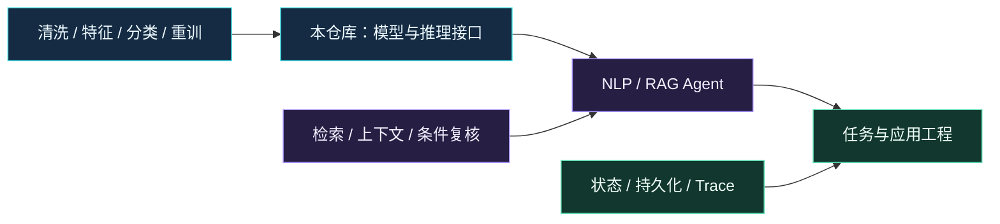
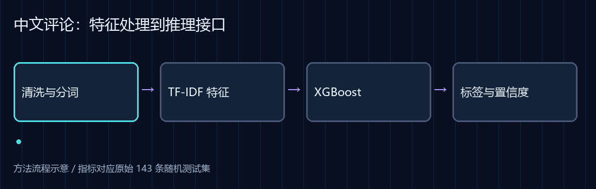
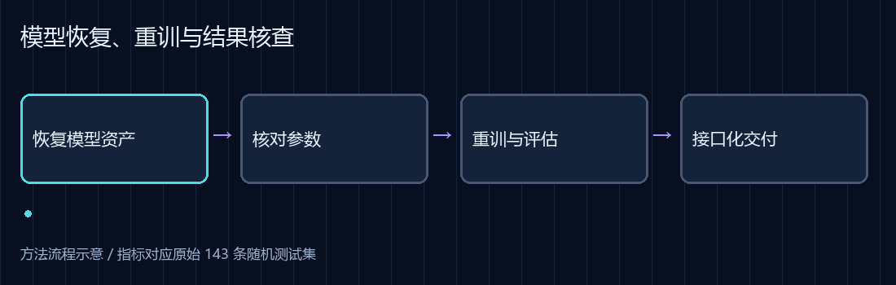

# 中文情感分析模型与推理 API

**Python · jieba · TF-IDF · XGBoost · scikit-learn · FastAPI**

[个人技术作品集](https://github.com/KristenYue) · [后续 NLP / RAG Agent](https://github.com/KristenYue/public-opinion-agent-eval)

将本科毕业设计中的中文情感分类代码整理为**可加载、可预测、可评估、可重训、可通过 API 调用**的模型应用。

输入中文评论，完成清洗、分词、特征转换与三分类推理，输出 `Negative / Neutral / Positive` 标签及置信度。项目保留原始模型与重训资产，分别核对指标和加载版本。

---

## 项目演进与能力证据



本仓库提供模型训练与推理基座。后续项目进一步处理新事件背景、检索证据与人工复核，不把不同数据切分上的指标混为同一结果。

---

## 核心结果

原始毕设测试集为 **143 条随机划分样本**：

| 模型资产 | Accuracy | Macro-F1 | 用途 |
|---|---:|---:|---|
| 原始模型恢复 | **90.21%** | **87.82%** | 核对历史资产与推理链路 |
| 使用原模型参数重训 | **90.91%** | **88.56%** | 验证可重训交付路径 |

重训相较原模型恢复结果：

- Accuracy：**+0.70 个百分点**
- Macro-F1：**+0.74 个百分点**
- 新向量器使用稳定模块路径保存 Tokenizer，不再依赖历史 `__main__.jieba_tokenizer` 兼容层。

这组结果用于原毕设主链路复现，不解释为跨事件泛化能力。

[原始模型评估结果](evaluation_results.json) · [评估脚本](scripts/evaluate.py) · [训练脚本](scripts/train.py)

---

## 场景一：中文评论到在线预测



> 方法流程示意动画；模型结果对应原始测试集，非线上生产效果。

### 处理流程

```text
中文评论
  → 文本清洗
  → jieba 分词
  → TF-IDF
  → XGBoost 三分类
  → 标签与置信度
  → API 响应
```

### 模块与职责

| 模块 | 完成的工作 | 源码 |
|---|---|---|
| **文本预处理** | 统一训练与推理阶段的清洗逻辑 | [preprocessing.py](src/sentiment_system/preprocessing.py) |
| **分词接口** | 提供可复用、可序列化的 Tokenizer | [tokenizer.py](src/sentiment_system/tokenizer.py) |
| **模型封装** | 加载特征与模型资产，执行单条及批量预测 | [classifier.py](src/sentiment_system/classifier.py) |
| **推理 API** | 健康检查、单条预测、批量预测 | [api.py](src/sentiment_system/api.py) |

### 工程设计

- **预处理一致性**：将清洗与分词放入稳定模块，减少训练、评估和 API 路径之间的差异。
- **资产成套加载**：模型、TF-IDF 向量器与标签编码器共同构成推理版本。
- **显式版本选择**：通过资产目录选择原始或重训版本。
- **加载状态可查询**：健康检查返回实际资产路径与特征维度，便于核查版本。

---

## 场景二：模型恢复、重训与兼容性处理



> 流程示意展示资产恢复与重训步骤，指标以对应评估记录为准。

### 实际工程问题

原 TF-IDF 向量器序列化时引用了 `__main__.jieba_tokenizer`。离开原训练脚本后，直接加载容易出现函数路径兼容问题。

### 处理方式

| 阶段 | 实现 |
|---|---|
| **恢复历史资产** | 在推理封装中提供兼容处理，重新跑通原始模型 |
| **核对参数** | 从已有模型读取参数，保留历史资产 |
| **重训与整理** | Tokenizer 使用稳定模块路径，输出独立重训目录 |
| **评估与接口** | 核对预测结果，并通过健康接口确认加载版本 |

原始模型保留在 `artifacts/`，重训结果输出到 `artifacts/retrained/`，避免覆盖已验证资产。

---

## API 交付

| 接口 | 功能 |
|---|---|
| `GET /health` | 查看加载状态、资产路径与特征维度 |
| `POST /predict` | 单条评论预测 |
| `POST /predict/batch` | 批量评论预测 |
| `/docs` | Swagger 接口文档 |

单条预测请求示例：

```json
{
  "text": "这个政策非常好，我很支持"
}
```

API 默认优先使用完整的重训资产；需要对照原始模型时显式设置资产目录。

---

## 运行方法

### 安装

```powershell
python -m venv .venv
.\.venv\Scripts\python.exe -m pip install -r requirements.txt

$env:PYTHONPATH = "src"
```

### 原始模型评估

```powershell
.\.venv\Scripts\python.exe scripts\evaluate.py
```

脚本默认读取本地 `data/split/测试集.csv`，结果写入 `evaluation_results.json`。

原始数据包含社交媒体身份字段，不随公开仓库发布。未取得本地数据时，可检查已公开结果与推理接口，但不能直接重跑同一评估。

### 启动 API

```powershell
.\.venv\Scripts\python.exe -m uvicorn sentiment_system.api:app --host 127.0.0.1 --port 8000
```

访问：

```text
http://127.0.0.1:8000/docs
```

使用原始资产进行接口对照：

```powershell
$env:SENTIMENT_ARTIFACTS_DIR = "artifacts"
```

环境变量应在启动服务前配置。

### 训练流程

快速运行：

```powershell
.\.venv\Scripts\python.exe scripts\train.py --quick
```

完整 GridSearchCV：

```powershell
.\.venv\Scripts\python.exe scripts\train.py
```

重训需要本地训练数据。快速模式与完整搜索分别用于流程检查与参数搜索，不能不经核查就视为相同实验。

### 自动检查

```powershell
.\.venv\Scripts\python.exe -m pytest
```

---

## 与后续 Agent 项目的指标关系

| 项目 | 数据口径 | 结果用途 |
|---|---|---|
| **本仓库** | 原始 143 条随机测试集 | 核对本科分类模型、资产恢复与重训 |
| **后续 NLP / RAG Agent** | 6 个未见事件、339 条冻结评论 | 比较跨事件自动研判与选择性复核 |

后续项目纯自动 Accuracy **31.27% → 56.05%**，属于另一套实验。不能把本仓库的 90.91% 与后续跨事件结果直接比较，也不能将其写成同一模型版本退化或提升。

[后续实验与指标口径](https://github.com/KristenYue/public-opinion-agent-eval/blob/main/docs/BENCHMARK_V1_5_RESULTS.md)

---

## 工程复盘

| 问题 | 处理原则 |
|---|---|
| 历史向量器依赖脚本内函数路径 | 先兼容恢复，再使用稳定模块路径重训 |
| 原始与重训模型混淆 | 分目录保存，健康检查显示实际加载资产 |
| 标签体系混用 | 当前主链路保持 Negative / Neutral / Positive 三分类 |
| 目录中有词典就被误认为特征融合 | 以实际训练代码为准，当前主链路为 TF-IDF + XGBoost |
| 随机测试结果被当作新事件能力 | 与后续事件隔离实验分别报告 |

---

## 目录与证据

```text
src/sentiment_system/   预处理、Tokenizer、模型封装与 API
artifacts/              原始模型、向量器与标签编码器
artifacts/retrained/    独立重训资产
scripts/evaluate.py     原始测试集评估
scripts/train.py        快速训练与完整搜索
tests/                  预处理、预测与资产兼容性检查
legacy/                 本科毕设原始脚本
evaluation_results.json 原始模型复现结果
```

<details>
<summary>数据与结果口径</summary>

公开仓库提供代码、可公开模型资产与已有结果。包含身份字段的原始 CSV 不随仓库发布。

143 条测试集结果属于原始随机划分，不作为跨事件或生产泛化结论。下游 RoBERTa、Reviewer 与 RAG 实验位于后续项目，不归入本仓库已实现模块。

</details>
